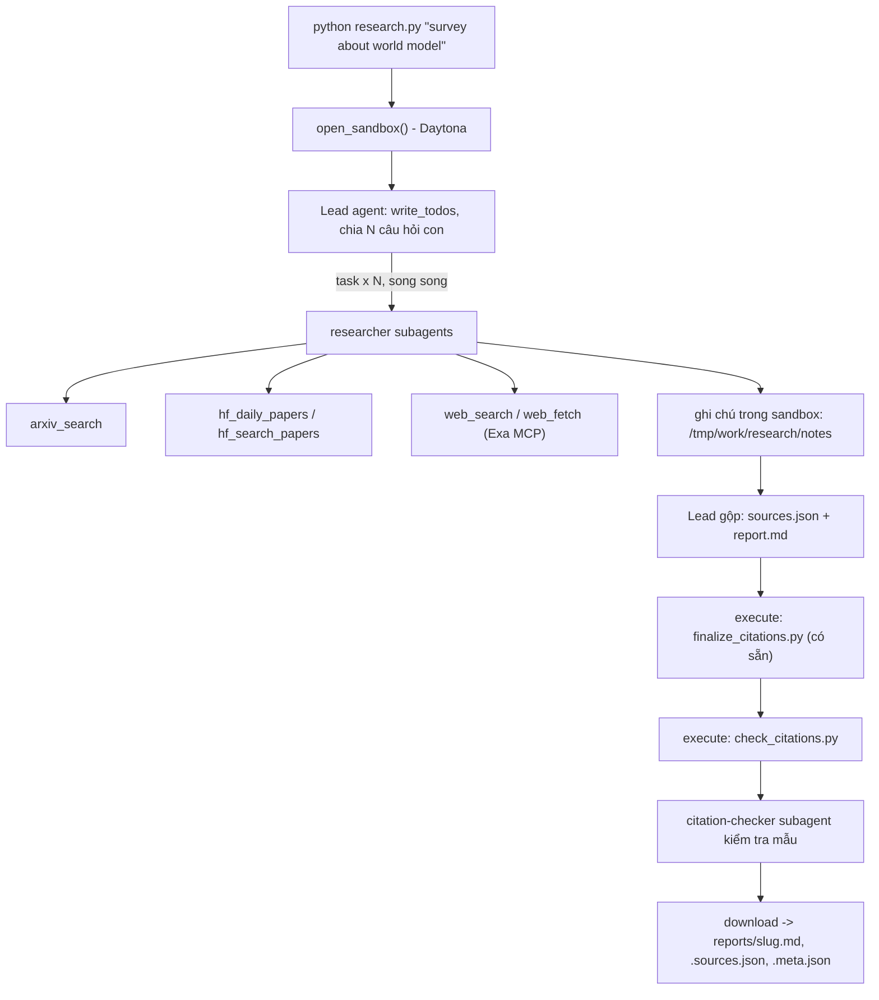

# Deep Research Agent (Deep Agents + Sandbox)

Lab dựng một **hệ thống deep research đa tác tử**: người dùng chỉ cần nhập một chủ đề (ví dụ `survey about world model`), hệ thống tự lập kế hoạch, giao việc cho nhiều subagent, tìm tài liệu trên arXiv, Hugging Face và web, rồi viết một **báo cáo có trích dẫn**.

Hình thức: **bài thực hành cá nhân**. Ngôn ngữ lập trình: Python 3.11 trở lên.

## Bản triển khai trong repo này

Đã hoàn thiện `tools.py`, `agents.py`, `research.py` và `check_citations.py`:
retry có backoff/jitter và `Retry-After`; throttle arXiv dùng chung giữa các luồng;
5 công cụ nguồn chạy trên host; prompt cho lead/researcher/citation-checker;
giới hạn model/tool cho lead và mọi subagent; kiểm tra trích dẫn và chỉ lưu kết quả hợp lệ.
Các tệp được cấp sẵn `model.py`, `sandbox.py`, `self_check.py` và
`finalize_citations.py` giữ nguyên.

**Chạy bằng 9router hoặc API tương thích OpenAI trên Google Colab:** mở [Deep_Research_Colab.ipynb](Deep_Research_Colab.ipynb).
Hoặc [mở bản GitHub trực tiếp trong Colab](https://colab.research.google.com/github/Neon310304/K4-Day23-AdvanceDeepAgents-Labs/blob/main/Deep_Research_Colab.ipynb).
Notebook dùng Daytona, đọc cấu hình và khóa từ Colab Secrets,
chạy lần lượt đủ 5 chủ đề, lưu kết quả vào Google Drive nếu chọn và xuất ZIP báo cáo.
Không cần GPU Colab khi gọi LLM API. Colab vẫn cần khóa LLM và Daytona có hạn mức.

Thêm Secrets `LAB_BASE_URL` (HTTPS endpoint kết thúc bằng `/v1`), `LAB_MODEL`
(đúng tên model trong dashboard, hỗ trợ tool calling), `LAB_API_KEY` và
`DAYTONA_API_KEY`; `EXA_API_KEY` là tùy chọn được khuyến nghị. Bật Notebook access.
Notebook ưu tiên khóa riêng `DAYTONA_LAB_API_KEY` nếu có. Cấu hình không chờ nhập
trong lúc chạy: khi thiếu biến, nó dừng và báo tên biến, không in giá trị khóa.

Ô cấu hình Colab chọn sẵn `MODEL_OVERRIDE="ag/gemini-3.1-pro-high"` cho kết nối
9router đã kiểm tra trong lần chạy này. Đặt giá trị này rỗng để dùng Secret
`LAB_MODEL`, hoặc đổi sang tên model của provider bạn chọn. Tên model là cấu hình
công khai; các khóa API vẫn chỉ lấy từ Secrets. Khi đã có đủ báo cáo hợp lệ,
ô kiểm thử bỏ qua gọi mạng/model và vòng chạy chỉ xác minh rồi lưu lại Drive.

9router làm cầu nối tới tài khoản mô hình đã kết nối, còn Daytona cung cấp sandbox.
Nếu 9router chạy trên máy cá nhân, lấy tunnel HTTPS đang hoạt động từ dashboard:
`localhost` trên Colab là máy Colab, không phải máy cá nhân. Giữ máy chạy 9router
và tunnel hoạt động trong suốt lần chạy. Không commit tunnel hoặc khóa cá nhân.
Các provider tương thích khác cũng dùng ba biến `LAB_*` trên; ví dụ YesScale có
base URL `https://api.yescale.io/v1`, OpenAI có `https://api.openai.com/v1`.

Để dùng ngay mã đang có trên máy, tạo gói upload (không chứa `.env`, khóa hay `.venv`):

```bash
python scripts/package_colab.py
```

Notebook mặc định lấy mã từ GitHub. Để dùng bản local chưa push, đổi `SOURCE`
sang `upload` và tải `colab_bundle.zip` vào ô đầu. Gói chỉ chứa mã và kiểm thử.

**Chạy local trên Windows PowerShell:**

```powershell
py -3.12 -m venv .venv
.venv\Scripts\python.exe -m pip install -r requirements.txt
Copy-Item .env.example .env
# Điền .env: LLM hỗ trợ tool calling + Daytona, hoặc SANDBOX=docker.
# Nếu chọn Docker: khởi động Docker Desktop với Linux containers.
.venv\Scripts\python.exe -m unittest discover -s tests -v
.venv\Scripts\python.exe tools.py
.venv\Scripts\python.exe research.py --all --resume
.venv\Scripts\python.exe self_check.py
```

`--all` chạy tuần tự 5 chủ đề từ `topics.md` và dừng khi một chủ đề thất bại.
`--resume` chỉ bỏ qua các báo cáo đã hợp lệ, đủ 3 lần giao việc và 3 họ nguồn;
muốn tạo lại toàn bộ thì bỏ `--resume`. Lệnh một chủ đề vẫn giữ nguyên.

Nếu agent tạo báo cáo thiếu phần bắt buộc (ví dụ `## Trends and open problems`),
sai trích dẫn hoặc thiếu họ nguồn, hệ thống yêu cầu agent sửa dựa trên ghi chú
ngay trong sandbox hiện tại, tối đa 2 lượt với hạn mức riêng. Sau mỗi lượt sửa,
finalizer và validator chạy lại trước khi lưu. Token/tool calls của các lượt sửa
được cộng vào meta; lỗi ghi tệp ở host không kích hoạt lượt gọi LLM mới.

Lượt sửa dùng `recursion_limit=1000`: một lượt model/tool còn đi qua nhiều bước
middleware, nên mức `120` ở bản cũ có thể gây `GraphRecursionError` trước khi
dùng hết hạn mức. Trần công việc vẫn là 25 lần gọi model và 50 lần gọi tool mỗi
lượt sửa; tăng số bước đồ thị không tăng các hạn mức này.

Nếu Colab đang dùng bản cũ báo `Recursion limit of 120`, chạy ô sau rồi chạy lại
ô sinh báo cáo (thay đổi được ghi vào tệp nên vẫn còn sau khi reload module):

```python
import importlib, research
from pathlib import Path
path = Path(research.__file__)
code = path.read_text(encoding="utf-8")
path.write_text(code.replace("REPAIR_RECURSION_LIMIT = 120",
                             "REPAIR_RECURSION_LIMIT = 1000"), encoding="utf-8")
importlib.reload(research)
print(research.REPAIR_RECURSION_LIMIT)  # 1000
```

Bản `parallel-v3` gom ba lời gọi `task` thật do model tạo trước khi cho Deep Agents
chạy các researcher song song. Provider chỉ trả một lời gọi công cụ mỗi phản hồi
vẫn dùng được; ba lượt lập kế hoạch đều tính vào hạn mức model và token của lead.
Nếu model không tạo được lệnh hợp lệ hoặc thiếu ngân sách, hệ thống báo lỗi,
không tự tạo task hay số liệu để vượt kiểm tra.

Middleware thao tác tệp từ chối đường dẫn thư mục khi công cụ cần tên tệp,
và chuyển lỗi SDK khi đọc/ghi tệp thành thông báo lỗi đã che bí mật để agent
có thể sửa đường dẫn. Lỗi công cụ khác vẫn được truyền lên; giới hạn số lần
gọi và các điều kiện kiểm tra báo cáo vẫn giữ nguyên.

Công cụ `submit_report` nhận các phần báo cáo và nguồn theo schema bắt buộc,
đặt đúng các heading, rồi tải nội dung do model viết vào sandbox. Finalizer gốc
và hai validator chạy trong sandbox, kể cả kiểm tra lại họ nguồn sau khi loại
nguồn chưa được trích dẫn. Công cụ chỉ kiểm tra cấu trúc/trích dẫn; bằng chứng
khoa học vẫn phải lấy từ công cụ nguồn và được citation-checker kiểm tra mẫu.

Công cụ `validate_report` có cho cả lead và lượt sửa:
script thuần Python `validate_report.py` chạy trong sandbox, báo đồng thời lỗi
cấu trúc, trích dẫn và số họ nguồn thực tế. Danh mục ứng viên
`/tmp/work/research/source_candidates.json` giữ metadata nguồn trước khi finalizer
loại nguồn chưa trích dẫn; số citation cũ được bỏ đi để tránh dùng nhầm. Agent
phải đọc ghi chú bằng chứng rồi trích dẫn nguồn đó trong thân báo cáo. Khi thiếu
bằng chứng, lượt sửa có thể gọi trực tiếp công cụ nguồn trên host để tìm thêm.
Không hạ điều kiện 3 họ nguồn, không đổi nhãn provenance để vượt kiểm tra.

Colab bật `LAB_DIRECT_PRIMARY_FETCH=1`: `web_fetch` đọc HTML công khai của bài
trên arXiv, ACL Anthology và Hugging Face trực tiếp ở host, có retry và che khóa
trong chẩn đoán. Script/style trong HTML được loại khỏi văn bản. Các URL khác
và PDF vẫn dùng Exa MCP; `web_search` luôn dùng Exa. Tùy chọn này giảm phụ thuộc
giới hạn Exa miễn phí khi kiểm tra lại bài gốc, không đổi nhãn nguồn `web` hay
đưa công cụ mạng vào sandbox. Local có thể bật cùng biến; mặc định dùng Exa.

Cảnh báo `Sandbox glob could not read ... under '/'` không phải nguyên nhân lỗi
đa nguồn; prompt yêu cầu tìm tệp trong `/tmp/work/research/notes` thay vì thư mục gốc.

**Cập nhật mã trong Colab đang chạy:** chạy lại ô cài đặt đầu tiên và tải gói
`colab_bundle.zip` mới lên. Nếu notebook cũ đã import mã, chạy thêm một ô:

```python
import importlib, sys
importlib.invalidate_caches()
for name in ("validate_report", "tools", "workflow", "agents", "research"):
    if name in sys.modules:
        importlib.reload(sys.modules[name])
import research
print(research.PIPELINE_VERSION)  # parallel-v3
```

Sau đó chạy lại ô sinh báo cáo. Các báo cáo đã lưu và hợp lệ sẽ được bỏ qua;
chủ đề đã thất bại được chạy lại vì sandbox của lần lỗi đã được dọn dẹp.

Đọc kết quả theo bộ ba trong `reports/`: `.md` là báo cáo tiếng Anh có trích dẫn;
`.sources.json` là danh mục nguồn; `.meta.json` ghi chủ đề, model, thời gian,
task/tool calls, số nguồn, họ nguồn và token của **lead** (không gồm token subagent).
Hai tệp báo cáo/nguồn được lưu đúng bytes tải từ sandbox; chạy lỗi không ghi bộ kết quả mới.
Bộ kiểm thử dùng dữ liệu giả trong thư mục tạm, không tạo báo cáo để nộp.

Nếu kiểm tra nguồn phát hiện một lỗi nội dung trong báo cáo đã hợp lệ, dùng
`research.repair_existing(topic, ["mô tả lỗi và nguồn cần đối chiếu"])`.
Hàm tải bản hiện tại vào sandbox mới, yêu cầu agent lấy lại bằng chứng và nhờ
citation-checker kiểm tra ít nhất năm khẳng định, rồi tải bản sửa sau khi kiểm tra.
Không sửa báo cáo bằng tay. Metadata giữ số task/token đã đo của lượt trước,
cộng lời gọi thật của lượt sửa và ghi riêng model/thời gian/token trong `revisions`.
Nếu sửa thất bại, bộ tệp hiện tại vẫn được giữ nguyên.

Đã chạy đủ **5 chủ đề** bằng LLM và sandbox Daytona thật trên Colab;
15 tệp kết quả nằm trong [`reports/`](reports/) và được lưu vào Drive sau mỗi chủ đề.
[`SUBMISSION_REVIEW.md`](SUBMISSION_REVIEW.md) ghi kết quả kiểm tra, đối chiếu RUBRIC
và mẫu bằng chứng của từng báo cáo. [`REPORTS.sha256`](REPORTS.sha256) dùng để
đối chiếu nguyên vẹn các tệp đã tải từ sandbox. Điểm tự đánh giá không thay thế
điểm chính thức của giảng viên.

## 1. Mục tiêu học tập

Sau lab, bạn có thể:

1. Dựng agent bằng thư viện Deep Agents (LangChain): công cụ (tool), system prompt, subagent, backend.
2. Dùng **sandbox** (Daytona) làm không gian làm việc và nơi chạy mã cho agent; hiểu vì sao khóa API và công cụ mạng phải nằm ở phía host chứ không nằm trong sandbox.
3. Viết công cụ gọi API ngoài **chịu được giới hạn tốc độ** (retry, backoff, jitter, `Retry-After`).
4. Thiết kế quy trình đa tác tử: lead chia nhỏ câu hỏi, giao cho N researcher chạy song song, tổng hợp và kiểm tra trích dẫn.
5. Tạo báo cáo có thể kiểm chứng: mọi khẳng định có `[n]` trỏ tới một nguồn có thật.

## 2. Hệ thống làm gì



Nguồn dữ liệu:

| Nguồn | Dùng để |
|---|---|
| arXiv API `https://export.arxiv.org/api/query` | Tìm bài theo từ khóa, sắp theo ngày |
| Hugging Face Daily Papers `/api/daily_papers` | Bài đang "trending": upvotes, githubRepo, summary |
| Hugging Face papers search `/api/papers/search?q=` | Tìm bài theo chủ đề |
| Web qua Exa MCP (`web_search_exa`, `web_fetch_exa`) | Blog, survey, trang dự án, nội dung đầy đủ của một URL |

## 3. Cấu trúc thư mục

```
Lab/
├── README.md  GUIDE.md  RUBRIC.md  REPORT_TEMPLATE.md   tài liệu
├── topics.md                 5 chủ đề cần chạy
├── requirements.txt  .env.example  .gitignore
├── model.py                  CÓ SẴN - không sửa: tạo mô hình LLM từ biến môi trường
├── sandbox.py                CÓ SẴN - không sửa: sandbox Daytona (hoặc Docker), upload, download
├── self_check.py             CÓ SẴN - không sửa: tự kiểm tra trước khi nộp (python self_check.py)
├── finalize_citations.py     CÓ SẴN - không sửa: script chạy trong sandbox, tự sinh `## References` và đánh số lại trích dẫn
├── tools.py                  SINH VIÊN CÀI ĐẶT: retry + 5 công cụ nguồn dữ liệu
├── agents.py                 SINH VIÊN CÀI ĐẶT: prompt, subagent, lead agent
├── research.py               SINH VIÊN CÀI ĐẶT: script chính
├── check_citations.py        SINH VIÊN CÀI ĐẶT: kiểm tra trích dẫn, chạy TRONG sandbox
└── reports/                  báo cáo sinh ra (bạn commit vào repo nộp)
```

Các tệp "SINH VIÊN CÀI ĐẶT" trong bản này đã có phần triển khai đầy đủ;
`GUIDE.md` mô tả yêu cầu gốc và `tests/` kiểm tra các trường hợp lỗi quan trọng.

## 4. Cài đặt

```bash
python3 -m venv .venv && source .venv/bin/activate      # Python 3.11+
pip install -r requirements.txt
cp .env.example .env                                     # rồi điền khóa CỦA BẠN
```

Bạn cần ba loại khóa (điền vào `.env`, **không bao giờ commit** `.env`):

| Khóa | Lấy ở đâu | Ghi chú |
|---|---|---|
| LLM (`LAB_MODEL` + khóa nhà cung cấp) | Nhà cung cấp bạn chọn (OpenAI, Anthropic, Google, OpenRouter, Ollama...) | Mô hình **phải hỗ trợ tool calling**. Chép tên mô hình từ tài liệu của nhà cung cấp. |
| `DAYTONA_API_KEY` | https://app.daytona.io | Kiểm tra gói miễn phí / credit hiện hành. Không có tài khoản hoặc hết credit: đặt `SANDBOX=docker` để chạy sandbox trong container Docker cục bộ (xem `.env.example`). |
| `EXA_API_KEY` (khuyến nghị) | https://dashboard.exa.ai/api-keys | Có thể chạy không khóa, nhưng bản miễn phí của MCP bị giới hạn tốc độ rất nhanh. |

## 5. Làm bài

Làm theo thứ tự (chi tiết trong `GUIDE.md`):

1. `check_citations.py`: khởi động nhẹ, thuần Python.
2. `tools.py`: viết `with_retry` và 5 công cụ. Thử riêng từng công cụ: `python tools.py`.
3. `agents.py`: viết prompt, subagent và lead agent.
4. `research.py`: ghép tất cả; chạy một chủ đề:

```bash
python research.py "survey about world model"
```

Kết quả nằm ở `reports/survey-about-world-model.md` cùng `.sources.json` và `.meta.json`.

## 6. Chủ đề và nộp bài

- Chạy đủ **5 chủ đề** trong [`topics.md`](topics.md), mỗi chủ đề một lần.
- Commit mã nguồn và toàn bộ `reports/`, đẩy lên một **public repo** GitHub và nộp link.
- Kiểm tra trước khi nộp: chạy **`python self_check.py`** (không tốn token): nó kiểm tra đủ 5 báo cáo, `meta.json`, trích dẫn bằng `check_citations.py` của bạn, và không có `.env`/khóa nào trong git.
- Cách chấm: xem [`RUBRIC.md`](RUBRIC.md).

## 7. Thời gian, chi phí và an toàn

- Dùng một mô hình **rẻ nhưng hỗ trợ tool calling**, và **đặt giới hạn** (số lần gọi mô hình/công cụ cho lead và subagent, `recursion_limit`): một prompt hỏng có thể khiến agent lặp rất lâu. Đây là hạng mục 2.5 của `RUBRIC.md`.
- Kết quả có tính ngẫu nhiên: cùng một mã có thể cho báo cáo hợp lệ ở lần này và trích dẫn lỗi ở lần sau. Hãy sửa **prompt và mã**, không sửa tay báo cáo.

- Mỗi lần chạy tốn token LLM và thời gian sandbox. `tokens` trong `meta.json` chỉ đếm tin nhắn của lead, chưa gồm subagent, nên chi phí thật cao hơn. `open_sandbox()` luôn dừng và xóa sandbox khi kết thúc, kể cả khi lỗi. Đừng bỏ qua nó.
- **Không đưa bí mật vào sandbox.** Sandbox không ngăn được prompt injection hay việc đẩy dữ liệu ra mạng; một trang web độc hại có thể khiến agent chạy lệnh bên trong sandbox. Vì vậy mọi công cụ gọi mạng và mọi khóa ở lại phía host.
- Nội dung lấy từ web là **dữ liệu không đáng tin**: agent không được làm theo chỉ dẫn nằm trong đó.
